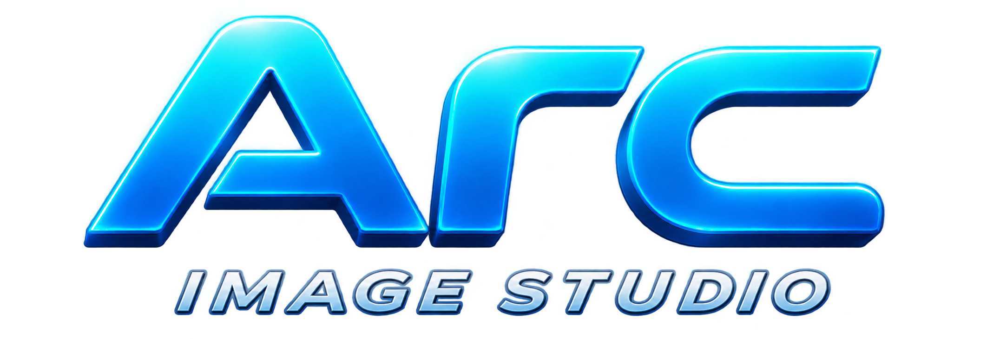

<p align="center">
  
</p>

# ARC Image Studio

Aplicativo para Windows que reúne compressor, resizer e limpeza de metadados de imagens em lote. Todo o processamento é local: nenhuma imagem é enviada para a internet e os arquivos originais nunca são alterados.

## Como usar

Na parte superior do aplicativo, escolha uma das ferramentas.

### Compressor

1. Selecione imagens JPG, JPEG ou PNG — ou uma pasta completa.
2. Escolha **Sem perda** para preservar todos os pixels ou **Redução forte** para arquivos menores com alta qualidade.
3. Defina a pasta de saída e clique em **Otimizar imagens**.

### Resizer

1. Selecione as imagens ou uma pasta completa.
2. Escolha como redimensionar:
   - **Dimensões:** informe largura e altura em pixels.
   - **Porcentagem:** reduza ou amplie em relação ao tamanho original.
   - **Redes sociais:** use formatos prontos para Instagram, Facebook, X, TikTok, LinkedIn e YouTube.
3. Use o controle de proporção para preservar a imagem sem deformação ou liberar largura e altura independentes.
4. Clique em **Redimensionar**.

### Limpeza de metadados

1. Selecione imagens JPG, JPEG ou PNG — ou uma pasta completa.
2. Selecione uma imagem do lote para consultar todos os metadados encontrados, organizados por grupo e com pesquisa por nome ou valor.
3. Confira o resumo de origem: localização GPS, dispositivo, data, software e possíveis sinais de geração por inteligência artificial.
4. Mantenha **Preservar perfil de cores** ativado para proteger a privacidade sem alterar a aparência das cores.
5. Clique em **Limpar todos os metadados**. O app verifica o arquivo final, confirma quando rastros de IA foram removidos e neutraliza nomes de arquivo que revelem diretamente geradores como ChatGPT, Gemini ou Midjourney.

O diagnóstico de IA utiliza informações presentes no próprio arquivo, como Content Credentials/C2PA, `DigitalSourceType`, software gerador, prompts e parâmetros. A ausência desses sinais não comprova que uma imagem não foi gerada por IA, pois metadados podem ser removidos.

Se EXIF, GPS ou modelo da câmera já não existirem, o painel explica isso claramente. Serviços como WhatsApp e redes sociais podem reprocessar a imagem e apagar esses dados antes do download; o ARC Image Studio consegue ler e limpar o que ainda existe, mas não reconstruir informações já removidas. Para tentar preservar o arquivo original durante uma transferência, envie a foto como documento/arquivo.

Cada execução cria uma subpasta exclusiva, como `Lote 2026-11-05 14-30-12`, `Redimensionado 2026-11-05 14-30-12` ou `Metadados removidos 2026-11-05 14-30-12`. Ao terminar, o app mostra o caminho completo e oferece um botão para abrir a pasta.

## Recursos

- Processamento de até quatro imagens simultaneamente.
- Presets para posts, capas, perfis, anúncios, stories, reels, shorts e thumbnails.
- Preview grande e selecionável no resizer, com miniaturas leves no compressor.
- Simulação instantânea do resultado no preview ao alterar dimensões, proporção ou preset.
- Análise e remoção em lote de EXIF, localização, câmera, XMP, IPTC, comentários, software gerador, prompts e Content Credentials/C2PA.
- Inspetor completo de EXIF, GPS, IPTC, XMP, ICC, dados do fabricante, Photoshop, JFIF e estruturas específicas de cada formato.
- Diagnóstico de origem com evidências de IA, dispositivo, software, autor, data e coordenadas, além de aviso quando o arquivo já chegou sem EXIF.
- Verificação posterior da remoção de rastros de IA no arquivo resultante.
- Pesquisa e filtros por grupos de metadados.
- Opção de preservar o perfil de cores durante a limpeza de metadados.
- Alta qualidade para JPG e PNG.
- Interface separada em abas, preservando o lote de cada ferramenta.
- Funcionamento offline e originais protegidos.
- Atualizações pelo próprio aplicativo: ele consulta os releases públicos do GitHub e instala uma versão nova com um clique.

## Desenvolvimento

Requer [Node.js](https://nodejs.org/) 22 ou superior.

```powershell
npm install
npm start
```

Para testar e gerar o instalador do Windows:

```powershell
npm test
npm run dist
```

O instalador será criado na pasta `release`.

## Publicar uma atualização

O aplicativo procura releases públicos em `MarcellResende/arc.ImageStudio`. Para publicar corretamente, atualize o campo `version` do `package.json`, faça o commit e envie uma tag com a mesma versão:

```powershell
git tag v2.4.0
git push origin v2.4.0
```

O workflow do GitHub executa os testes, cria o instalador NSIS e publica automaticamente o `.exe`, o `.blockmap` e o `latest.yml` no release. Esses três arquivos precisam ser gerados juntos; não substitua apenas o instalador manualmente.

## Licença

Distribuído sob a licença MIT.
